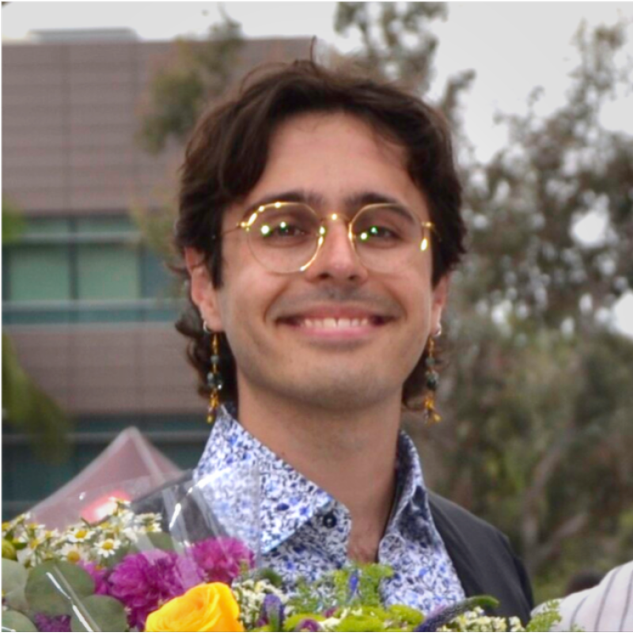
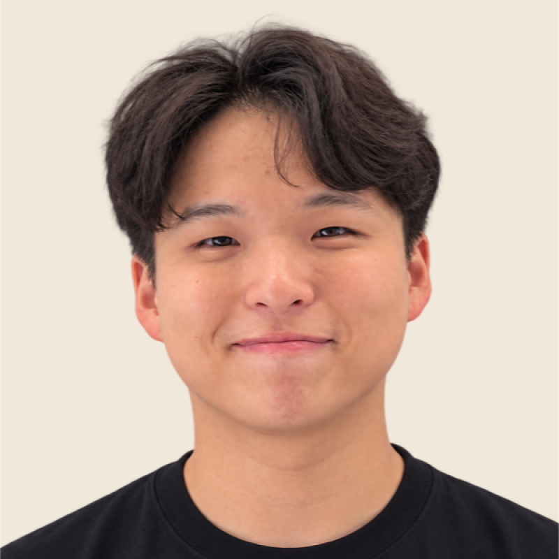
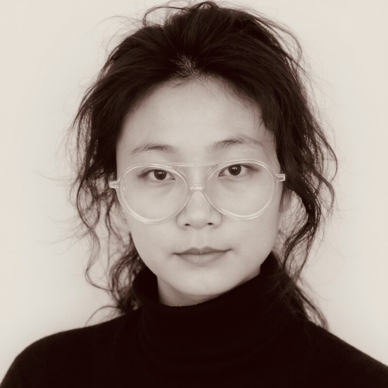
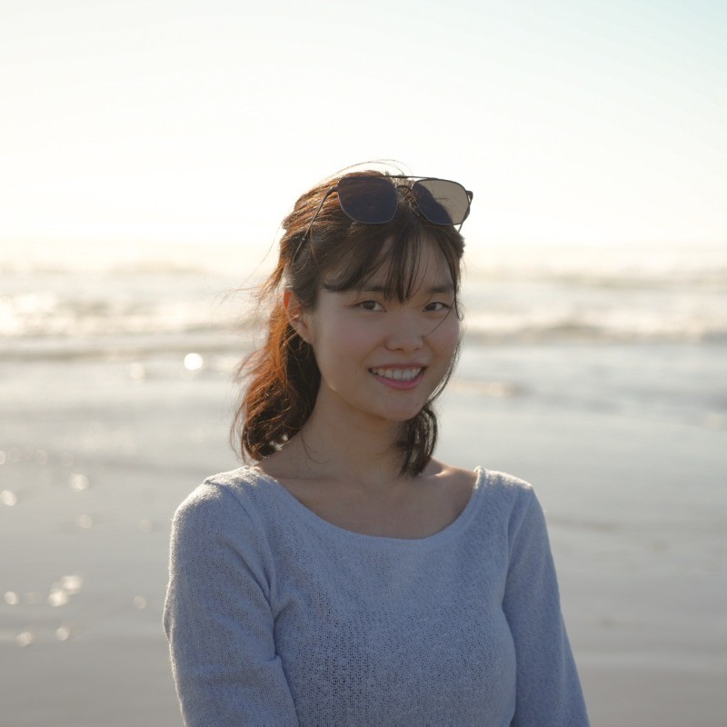
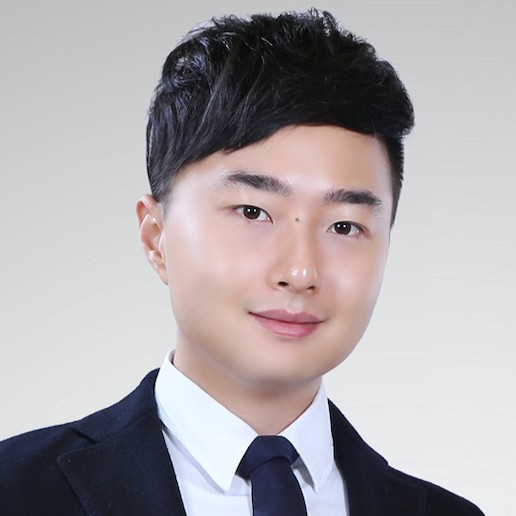

:::{div}
:class: ml-hero

# Large Language Models unlock {span .ml-highlight}`music applications.`

:::

Welcome to the online supplement for the tutorial on "LLMs × Music: Scalable Language Modeling Unlocks Music Applications," presented at the [27th International Society for Music Information Retrieval (ISMIR) Conference](https://ismir2026.ismir.net/) in 2026 in Abu Dhabi, UAE.

## Motivation & Aim

Large language models (LLMs) are rapidly becoming a foundation for user-facing
systems, with the potential to transform how people discover, understand,
create, produce, perform, and learn music. Moving beyond a surface-level
treatment of LLM usage, this tutorial offers an in-depth exploration of the
capabilities that make these models particularly powerful for musical
applications, showing how they can enable meaningful experiences for listeners,
creators, performers, and learners.

We first introduce the foundations of modern LLMs, from large-scale pretraining
to instruction tuning and preference alignment. We then show how their core
capabilities support agentic pipelines that reason, call specialized tools, and
interact with environments. Next, we explore how LLMs connect information across
audio, symbolic notation, score images, and textual metadata for music
understanding. Building on these foundations, the tutorial emphasizes
applications designed around the needs of music users: conversational
recommendation for listeners; collaborative composition for creators; and
personalized assessment, coaching, and interactive education for performers and
learners.

Participants will learn how the core capabilities of LLMs translate into
practical applications for music users. The tutorial concludes by examining
current limitations and promising directions for more capable, grounded, and
musically meaningful systems.

% Main figure: re-enable once book/assets/main-figure.svg is added back.
% :::{figure} assets/main-figure.svg
% :name: fig-main
% :alt: Tutorial overview by chapter: large language models and agents, LLM-powered music understanding across audio, symbolic notation, score images, and textual metadata, and applications for music listening, composition and co-creation, and feedback and music education.
%
% The tutorial by chapter: we start from large language models and agents
% (Chapter 1), connect them to music across modalities (Chapter 2), and build
% applications for listening, co-creation, and education (Chapters 3–5).
% :::

## Presenters

:::{div}
:class: ml-presenters

-  [Zachary Novack](https://zacharynovack.github.io/) {span .ml-affil}`Spotify`

  Zachary Novack is a Research Scientist at Spotify in the Artist First AI-Music
  Lab. Graduating in 2026 with a PhD from UC San Diego, Zachary’s research has
  focused both on efficient interactive music generation and large scale
  evaluation and benchmarking for LLMs for musical reasoning. He has received
  numerous awards across diverse venues, including oral presentations at ICML,
  ICASSP, and Interspeech, spotlight papers at ICLR and NeurIPS, and recently
  Best Paper at ISMIR 2025 for work on diagnosing Music-LLM evaluation. He
  co-presented the tutorial “Connecting Music Audio and Natural Language” in
  ISMIR 2024 and organized the AI Music workshop at NeurIPS 2025. Outside of
  academics, Zachary is passionate about music education and teaches
  competitive indoor drumline in the southern California area.

-  [Seungheon Doh](https://seungheondoh.github.io/) {span .ml-affil}`Sony`

  Seungheon Doh is a Research Scientist at Sony. His research focuses on
  conversational music understanding, recommendation, and creation. Recently,
  he has been particularly interested in agentic media processing, where
  language models coordinate tools to understand and transform multimodal
  media. He has
  published research on large language models for music applications at venues
  including ISMIR, ICLR, IEEE ICASSP, and IEEE TASLP. He co-presented a tutorial
  on "Connecting Music Audio and Natural Language" at ISMIR 2024 and has
  organized several workshops (NLP4Musa, LLM4MA) exploring the intersection of
  music and language. Seungheon has interned at Sony AI, Adobe Research,
  Chartmetric, NAVER, and ByteDance.

-  [Huan Zhang](https://www.huanz.space/) {span .ml-affil}`Clefer`

  Huan Zhang is a Research Scientist at Clefer Inc., exploring how LLMs can
  understand, generate, and evaluate performance expression in music. She has
  developed multimodal models such as LLM coach that provides formative feedback
  on performances, and framework for text-controlled expressive performance
  generation. Huan has collaborated with industry leaders such as Sony CSL and
  Yamaha, and is deeply committed to applying her research to music education.
  Huan also serve as the MIREX Task Captain of RenCon (Expressive Performance
  Rendering Competition) and Music Performance Difficulty.

-  [Yewon Kim](https://yewon-kim.com/) {span .ml-affil}`Carnegie Mellon University`

  Yewon Kim is a Ph.D. student in the Computer Science Department at Carnegie
  Mellon University, where she is advised by Chris Donahue. Yewon's research
  explores how generative AI can enhance human creativity in music, developing
  interactive systems and methods for human-AI music co-creation. She has
  published across HCI (ACM CHI, ACM DIS) and AI (NeurIPS) venues, and was
  recognized with a Best Paper Award at ACM CHI. She has also interned at Adobe
  Research.

-  [Sang-gil Lee](https://l0sg.github.io/) {span .ml-affil}`NVIDIA`

  Sang-gil Lee is a Research Scientist on the Applied Deep Learning Research
  team at NVIDIA, where his research focuses on audio AI across sound, music,
  and speech. He received his PhD in Electrical and Computer Engineering from
  Seoul National University. His research spans neural waveform synthesis,
  audio codecs, audio generation, and multimodal audio-language models. He has
  contributed to a number of influential audio AI systems, including BigVGAN,
  ETTA, Audio Flamingo 3, Music Flamingo, UALM, and Nemotron-Labs-Audex. His
  recent work explores unified audio-language models that jointly support
  understanding, generation, and reasoning across sound, music, and speech.
:::

:::{note}
This site is under active development. Text marked **TODO** is a writing prompt,
not finalized tutorial content.
:::
